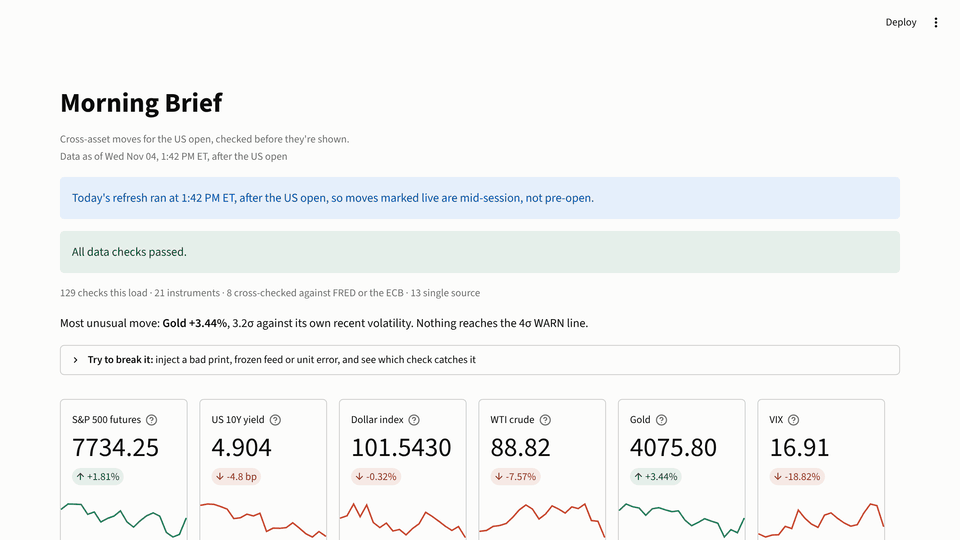
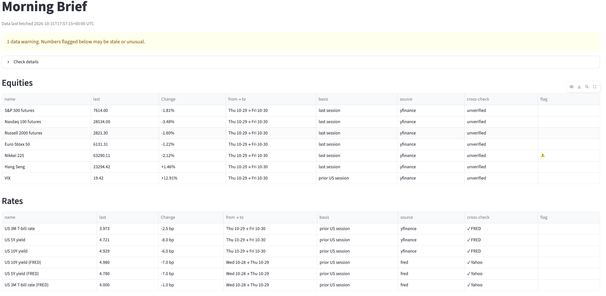
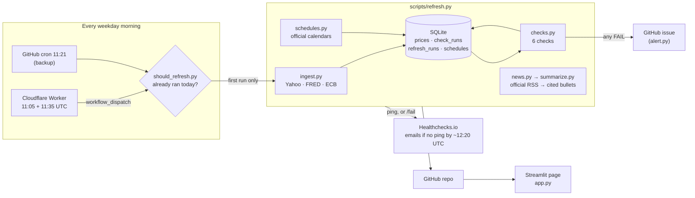

# Morning Brief


**Live app:** https://kechun-morning-brief.streamlit.app

A pre-open cross-asset dashboard that **tells you when its own data is wrong**: stale, frozen, implausible, or disagreeing with a second source. Every number shows where it came from, when, and whether anything vouches for it.



## Why I built this

During my 2026 sales & trading internship I built a morning dashboard that 30+ traders and salespeople used every day. Its one real weakness: when a data source arrived late or incomplete, the page still loaded and looked normal. Nobody can tell a stale number from a fresh one by looking at it.

This is a public rebuild around fixing that. No code or data from the original is used; everything runs on free public sources with reuse terms I've checked.

## What a visitor sees

- **Data as of**, in New York time, labeled pre-open or after the open, with a yellow banner if today's pre-open refresh hasn't run by 8:00 AM ET and a red one if the data is more than a weekday old
- **A status banner and what it covers,** e.g. "129 checks · 21 instruments · 8 cross-checked against FRED or the ECB · 13 single source"
- **The day's most unusual move**, measured against that instrument's own volatility with the sanity check's own number, so it can't disagree with the flags
- **Try to break it:** first a real disagreement (Yahoo vs FRED on the VIX, Feb 6, 2026) replayed through the real check, then inject your own bad print, frozen feed, stale ticker or unit error into an in-memory copy
- **Latest change** for 21 instruments across equities, rates, FX and commodities, each with from → to dates, basis (live, last session or prior US session), source and cross-check
- **How unusual is today?** every instrument ranked in robust standard deviations
- **Copy today's note:** a plain-text morning note for chat or email, with the same numbers and caveats as the page, flagged rows first
- **What's scheduled today** from official calendars (BEA, Census, FOMC, ECB, Treasury), stating plainly that BLS isn't covered
- **Overnight news:** 0–5 LLM bullets from official feeds, each linked to the headlines it cites
- **Track record:** every logged refresh, when it ran, what started it, and every WARN or FAIL the checks have raised



## Data checks

Every refresh runs these before anything is displayed:

| Check | What it catches | Example |
|---|---|---|
| Freshness | A feed that didn't update | Copper's latest close is 3 sessions old → FAIL |
| Completeness | A ticker with no stored data, too little history, or zero or missing prices | New ticker has no rows → FAIL; only 1 row → WARN |
| Gaps | Holes in recent history | 5 missing sessions in the last 60 → WARN; market holidays don't count |
| Sanity | Moves too large to be real | A 1%-vol asset "moves" 50% → FAIL, almost certainly bad data |
| Frozen feed | A price that hasn't changed in two weeks | Last 10 daily changes all zero → FAIL |
| Reconciliation | Two sources disagreeing | Yields, VIX, USD/JPY, GBP/USD and WTI vs FRED; EUR/USD vs the ECB. 10Y differs by ≥15bp → FAIL |

Tolerances were set from measured gaps between the sources (build notes 12 and 21), not picked by hand. Results go into a `check_runs` table:

```sql
SELECT ticker, check_name, COUNT(*) AS failures
FROM check_runs WHERE status = 'FAIL'
GROUP BY 1, 2 ORDER BY failures DESC;
```

## How it works



| File | Role |
|---|---|
| `scripts/refresh.py` | Runs the pipeline once |
| `streamlit_app/app.py` | The Streamlit version of the page (root `app.py` just runs it) |
| `src/morning_brief/checks.py` | The six checks; `run_all` is what the page and the demo both call |
| `src/morning_brief/runs.py` | Pre-open timing, the refresh guard, the as-of label |
| `src/morning_brief/demo.py`, `incidents.py` | Simulated faults, and the real VIX disagreement replay |
| `src/morning_brief/history.py` | The track record |
| `ops/scheduler/` | The Cloudflare Worker trigger and its setup steps |
| `.github/workflows/refresh.yml` | Weekday refresh, guard, alert and heartbeat |
| `.github/workflows/ci.yml` | Tests on the latest versions and on Streamlit 1.51, on every push and weekly |

## Reliability

GitHub's scheduled trigger missed the first three weekdays and then started 7h20m late, so the refresh now has three triggers and an outside monitor:

- A **Cloudflare Worker** calls `workflow_dispatch` (which has started every time it's been called here) at 11:05 and 11:35 UTC; GitHub's cron at 11:21 is a backup.
- A **guard step** lets the first automatic run of the New York day refresh and stops the rest; `concurrency` stops two runs racing on `git push`.
- **Healthchecks.io** emails if no refresh pings by about 12:20 UTC, so a run that never starts is noticed that morning. A run that fails its checks opens a GitHub issue, which closes after the next clean run.
- The **page itself** warns when today's pre-open refresh is missing or ran after the open.

The Worker and Healthchecks need a one-time setup with my accounts ([`ops/scheduler/README.md`](ops/scheduler/README.md)); until that's done, GitHub's cron is the only trigger and the page's own banner is the only alarm.

## LLM summary guardrails

- The model sees only the headlines passed in and is told not to add outside facts
- Every bullet must cite headline IDs; bullets citing IDs that were never sent are dropped automatically
- Prompts and raw responses are saved so summaries can be reviewed afterward
- With no API key or on any error, the page falls back to raw headlines instead of breaking
- Nothing else on the page uses an LLM: the headline move, the schedule and the checks are all computed

## Run it locally

```bash
pip install -r requirements.txt
export ANTHROPIC_API_KEY=...      # optional; without it you get headlines only
python scripts/refresh.py
streamlit run streamlit_app/app.py
pytest -q
```

## Known limitations

- **BLS isn't covered:** its site returns 403 to automated requests, so CPI and jobs reports are missing from the schedule. The page says so every day.
- **13 of 21 instruments are single source.** Nikkei's FRED series and Stooq would add more, but their terms don't allow redistribution on a public page (build note 21).
- Freshness and gap checks use market holiday calendars matched to what each source publishes, but sources don't follow them perfectly: Yahoo's Euro Stoxx 50 skipped about 7 days in two years that Xetra counts as sessions.
- Sanity thresholds (4 and 10 standard deviations) are judgment calls, not tuned on enough live history yet.
- Free data sources have delays and occasional bad prints. That's part of why the checks exist, but this is not production market data.
- I check LLM summaries by reading them against the cited headlines, not with an automated accuracy test.

## What I learned / what's next

The starter code passed all 21 of its tests and still couldn't finish a real refresh: the tests used timezone-free times, and production didn't. Since then I test with the same kinds of inputs the code sees in production, and run against live data early. Some bugs only appeared on live data, like a crash when the API response started with a thinking block instead of text; most were found by testing with production-shaped inputs or by reviewing the code and the rendered page. Reading the AI summaries by hand taught me that citation checks prove a headline exists, not that it supports the bullet.

Next: tune the sanity thresholds on more live history, and find a licensed news source, because sticking to official feeds often leaves the brief empty.

## Built with

Python, pandas, SQLite, Streamlit, Altair, GitHub Actions and a Cloudflare Worker, with data from Yahoo Finance (via yfinance), FRED, the ECB and official RSS feeds and calendars. The starter code was generated with Claude. I then used Claude Code to find and fix bugs and build features, one commit and regression test at a time. Every bug, how it was found, what changed and the trade-offs are logged in [docs/build-notes.md](docs/build-notes.md), with an index of the judgment calls at the top.
